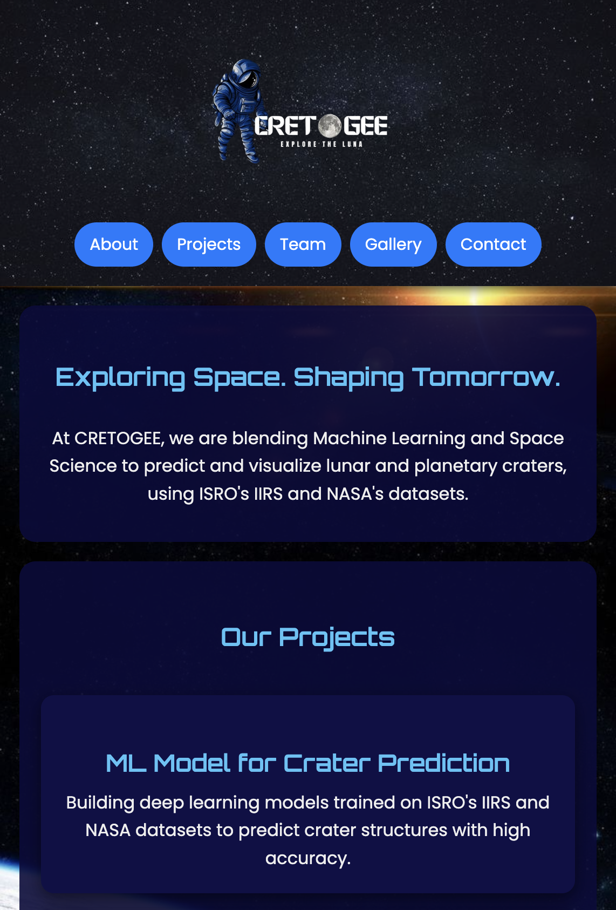
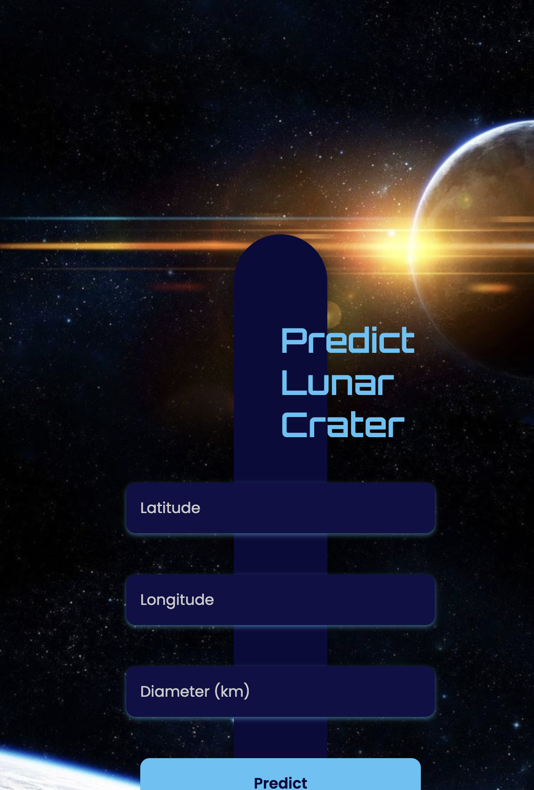
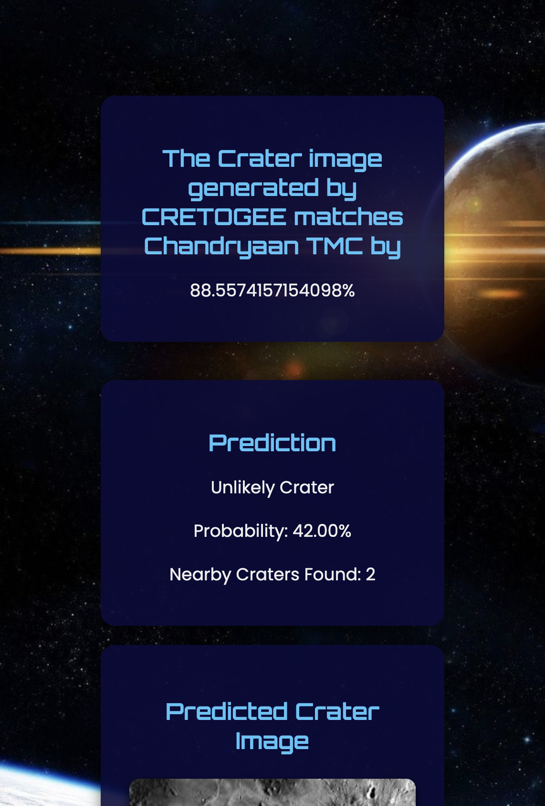

# Cretogee

A web tool for checking whether a point on the Moon is a crater, built against a Smart India Hackathon 2024 problem from ISRO.

[Live demo](https://cretogee.vercel.app)

## Why we built it

[SIH1732](https://vedas.sac.gov.in/static/pdf/SIH_2024/SIH1732_CH2_PS.pdf) on the [SIH 2024 problem list](https://www.sih.gov.in/sih2024PS) asks for software that can read permanently shadowed regions of lunar craters in Chandrayaan-2 OHRC images. Those floors never see sunlight. The signal is too weak for landing-site work or a close look at the surface, and the ask was to raise it into an image someone can actually interpret.

Cretogee is the piece we shipped for that problem. Before anyone spends time on a dark frame, they can ask a simpler question: is there a crater of this size at this latitude and longitude, and what else is catalogued around it?

## How it works

**1. Open the site.** The home page is the project: a crater check trained on a published lunar crater catalog.



**2. Enter a location.** Projects takes latitude, longitude, and a diameter in kilometres.



**3. Read the result.** A random forest scores the point as a likely or unlikely crater and returns a probability. The page then lists nearby craters from the catalog, including the largest and smallest in that neighbourhood, and shows a crater image.



The model is trained on catalogued craters as positive examples and random points on the Moon as negatives. Latitude, longitude, and diameter are the only inputs.

## Stack

Flask · HTML · CSS · pandas · scikit-learn

The model file is pulled from Hugging Face on first run. The site is deployed on Vercel.

## Run locally

```bash
git clone https://github.com/Pradeep-gif-hub/Cretogee-clean.git
cd Cretogee-clean
pip install -r requirements.txt
python app.py
```

Open [http://127.0.0.1:5000](http://127.0.0.1:5000). The first start downloads `model.pkl`.

## Team

Pradeep Kumar Awasthi, with Aman Gautam, Ayush, and Naveen Yadav.

[GitHub](https://github.com/Pradeep-gif-hub) · [LinkedIn](https://www.linkedin.com/in/pradeep-kumar-awasthi-9313a2280/)
